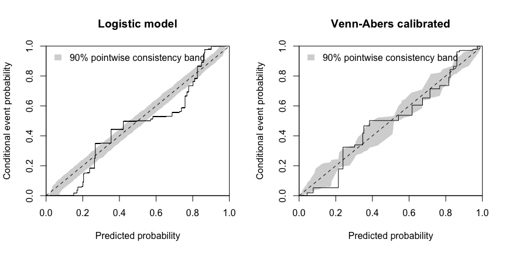

<!-- README.md is generated from README.Rmd with tools/build-readme.R. Edit README.Rmd. -->

# vennabers

<!-- badges: start -->

[](https://CRAN.R-project.org/package=vennabers)
[](https://github.com/RMKruse/vennabers/actions/workflows/R-CMD-check.yaml)
[](https://app.codecov.io/gh/RMKruse/vennabers)
[](https://opensource.org/license/mit)
<!-- badges: end -->

`vennabers` calibrates model predictions in R with Inductive or Cross
Venn-Abers methods. It supports binary classification, multiclass
classification (one-vs-one or one-vs-rest) and regression. Start with
[Venn-Abers methods and their
guarantees](https://rmkruse.github.io/vennabers/articles/method.html)
for what the predictors compute and what they guarantee.

You can calibrate predictions from a model you already have, or let
optional tidymodels workflows fit the model, create the calibration
splits and tune the complete procedure.

## Installation

`vennabers` requires R 4.5 or later. Install the released version from
CRAN:

``` r
install.packages("vennabers")
```

Or install the development version from GitHub:

``` r
# install.packages("pak")
pak::pak("RMKruse/vennabers")
```

Calibrating supplied predictions needs no additional packages. The
tidymodels workflows and the vignettes use the optional packages listed
under `Suggests` in `DESCRIPTION`.

## Example

Fit a calibrator with probabilities from a model trained on separate
data, then calibrate probabilities for new observations:

``` r
library(vennabers)

truth <- c(FALSE, TRUE, FALSE, TRUE)
uncalibrated <- c(0.1, 0.4, 0.35, 0.8)
calibrator <- venn_abers(truth, uncalibrated)

prediction <- predict(calibrator, c(0.2, 0.5, 0.9))
prediction
#>       lower upper probability
#> 1 0.0000000   0.5   0.3333333
#> 2 0.5000000   1.0   0.6666667
#> 3 0.6666667   1.0   0.7500000
brier_score(c(FALSE, TRUE, TRUE), prediction$probability)
#> [1] 0.09490741
```

`prediction` holds the `lower` and `upper` Venn-Abers bounds and a
regularized `probability`. The bounds are not confidence intervals.

With tidymodels installed, `calibrated_workflow()` trains a workflow and
its calibrator together:

``` r
data <- data.frame(
  x = sin(1:80),
  truth = factor(rep(c("yes", "no", "no", "yes"), 20))
)
base <- workflows::workflow() |>
  workflows::add_formula(truth ~ x) |>
  workflows::add_model(parsnip::logistic_reg(engine = "glm"))

fit <- calibrated_workflow(base, outcome = "truth", seed = 42) |>
  generics::fit(data)
predict(fit, data.frame(x = c(-0.5, 0.5)), type = "prob")
```

## Calibration at a glance

A logistic regression that is linear in `x` cannot follow event
probabilities of `plogis(x^3)`: it ranks cases correctly, but its
probabilities are off. Venn-Abers calibration on separate calibration
data corrects them. The CORP reliability diagrams compare both on a
third, independent assessment set; a well calibrated method follows the
diagonal inside the gray band.

``` r
set.seed(1)
simulate <- function(n) {
  x <- rnorm(n)
  data.frame(x = x, truth = runif(n) < plogis(x^3))
}
training <- simulate(500)
calibration <- simulate(1000)
assessment <- simulate(5000)

model <- glm(truth ~ x, family = binomial(), data = training)
score <- function(data) predict(model, data, type = "response")
calibrator <- venn_abers(calibration$truth, score(calibration))
calibrated <- predict(calibrator, score(assessment))$probability

par(mfrow = c(1, 2))
corp_plot(assessment$truth, score(assessment), seed = 1,
          main = "Logistic model")
corp_plot(assessment$truth, calibrated, seed = 1,
          main = "Venn-Abers calibrated")
```



`vignette("comparison")` adds Platt scaling and isotonic calibration and
states what one simulated data set can and cannot show.

## Overview

| Task | Function |
|----|----|
| Calibrate binary or multiclass probabilities | `venn_abers()`, `cross_venn_abers()` |
| Calibrate numeric predictions | `venn_abers_regression()`, `cross_venn_abers_regression()` |
| Fit and calibrate a tidymodels workflow | `calibrated_workflow()` |
| Calibrate an already fitted workflow | `calibrate_workflow()` |
| Use your own fit and predict functions in a workflow | `model_adapter()` |
| Inspect a fitted calibrator | `plot()` |
| Score and assess calibration | `brier_score()`, `log_loss()`, `calibration_plot()`, `corp_plot()`, `corp_decomposition_plot()`, `regression_plot()` |

## Documentation

The [package website](https://rmkruse.github.io/vennabers/) collects the
guides, the function reference and the example scripts. Start with
`?vennabers` for the package overview and with the method guide, then
follow the practical guides:

- [Venn-Abers methods and their
  guarantees](https://rmkruse.github.io/vennabers/articles/method.html):
  `vignette("method", package = "vennabers")`
- [Venn-Abers, Platt and isotonic calibration
  compared](https://rmkruse.github.io/vennabers/articles/comparison.html):
  `vignette("comparison", package = "vennabers")`
- [Calibrating supplied
  predictions](https://rmkruse.github.io/vennabers/articles/manual-calibration.html):
  `vignette("manual-calibration", package = "vennabers")`
- [Training and freezing calibrated
  workflows](https://rmkruse.github.io/vennabers/articles/workflows.html):
  `vignette("workflows", package = "vennabers")`
- [Tuning and assessing the complete
  procedure](https://rmkruse.github.io/vennabers/articles/tuning.html):
  `vignette("tuning", package = "vennabers")`
- [Diagnose and assess
  calibration](https://rmkruse.github.io/vennabers/articles/diagnostics.html):
  `vignette("diagnostics", package = "vennabers")`

Runnable example scripts for every interface are collected in
`?vennabers_examples`, and learned postprocessing is covered in
`?workflow_postprocessing`.

## Relationship to Python venn-abers

This is an independent R implementation. Its shared core results are
checked against reference outputs of the Python package
[venn-abers](https://github.com/ip200/venn-abers).
[`PARITY.md`](https://github.com/RMKruse/vennabers/blob/HEAD/inst/PARITY.md)
separates numerical parity from R extensions, documented deviations and
accepted limits.

## Stability

From 1.0.0 on, the user-facing functions, their arguments and defaults,
and their documented output formats stay compatible throughout 1.x. See
[NEWS](https://rmkruse.github.io/vennabers/news/index.html) for the full
promise.

## Contributing

Report problems in the [issue
tracker](https://github.com/RMKruse/vennabers/issues). See
[CONTRIBUTING](https://github.com/RMKruse/vennabers/blob/HEAD/.github/CONTRIBUTING.md)
for running the tests and building the documentation.

## Citation

Cite the package and the method papers you use with
`citation("vennabers")`.

## References

- Vovk and Petej (2014). Venn-Abers predictors.
  <doi:10.48550/arXiv.1211.0025>
- Vovk, Petej and Fedorova (2015). Large-scale probabilistic predictors
  with and without guarantees of validity.
  <doi:10.48550/arXiv.1511.00213>
- Manokhin (2017). Multi-class probabilistic classification using
  inductive and cross Venn-Abers predictors.
  <https://proceedings.mlr.press/v60/manokhin17a.html>
- Dimitriadis, Gneiting and Jordan (2021). Stable reliability diagrams
  for probabilistic classifiers. <doi:10.1073/pnas.2016191118>

## License

MIT
